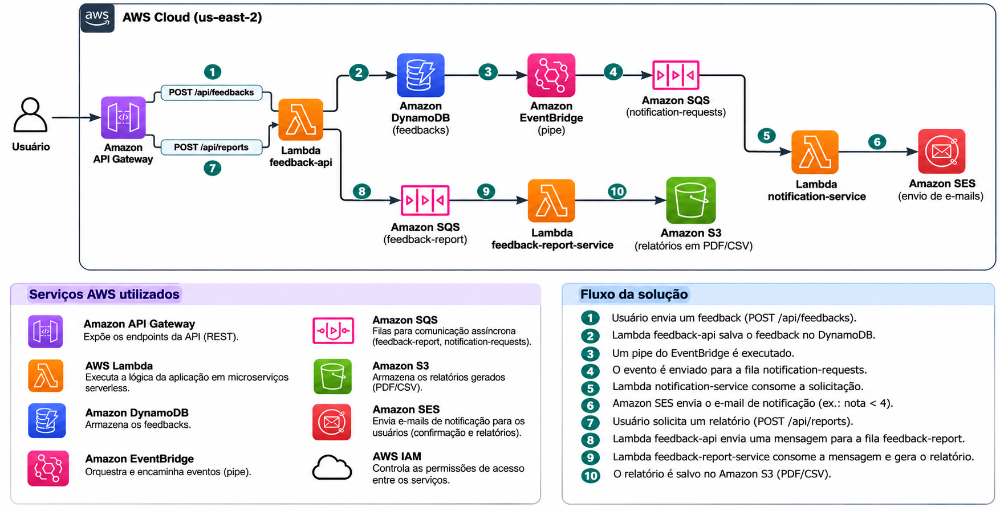
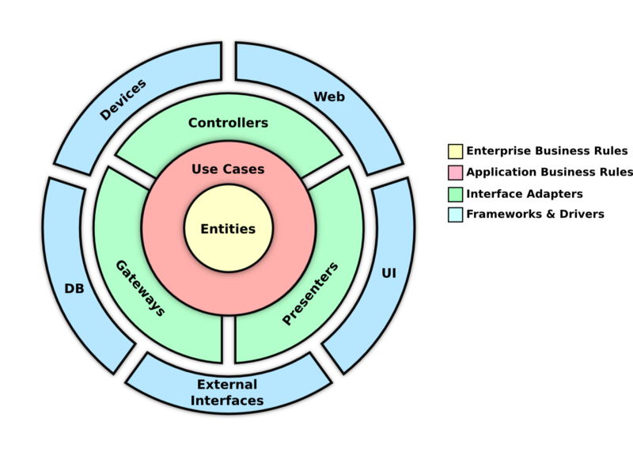

# Notification Service

Microsservico worker responsavel por consumir eventos de notificacao da fila SQS e enviar emails via Amazon SES, com suporte a anexos armazenados no S3.

## Descricao do projeto

> Para garantir a qualidade dos cursos on-line, e necessario que eventos de
> negocio disparem comunicacoes confiaveis para times internos e stakeholders.
> Este servico processa requisicoes de notificacao de forma assicrona, permitindo
> envio por email e preparando extensao para novos canais no futuro.

## Stack

- Java 21
- Quarkus 3.40.x
- AWS Lambda (handler Java)
- Amazon SQS (trigger)
- Amazon SES (envio de email)
- Amazon S3 (origem de anexos)
- Maven + JUnit 5

## Arquitetura da solução



## Arquitetura limpa



## Contrato do evento de entrada (SQS body)

```json
{
  "notificationId": "notification-123",
  "type": "EMAIL",
  "source": "feedback",
  "recipient": {
    "to": ["suporte@example.com"],
    "cc": [],
    "bcc": []
  },
  "subject": "Nova avaliacao critica recebida",
  "body": {
    "text": "Uma avaliacao critica foi recebida. ID: b661e71f-3c46-43e2-bd68-78d9597c256b. Nota: 3.",
    "html": "<h2>Nova avaliacao critica</h2><p>Uma avaliacao critica foi recebida.</p>"
  },
  "attachments": [
    {
      "bucket": "notifications",
      "key": "feedback/report.pdf",
      "fileName": "report.pdf",
      "contentType": "application/pdf"
    }
  ],
  "replyTo": [],
  "metadata": {
    "feedbackId": "b661e71f-3c46-43e2-bd68-78d9597c256b"
  }
}
```

Observacoes:

- `type` aceita `EMAIL` no estado atual.
- `attachments` tambem aceita aliases `bucketName` e `objectKey`.
- O servico busca anexos no S3 por bucket/chave e incorpora no MIME, sem presigned URL.

## Fluxo de processamento

1. O Lambda recebe mensagens da fila `notification-request`.
2. O handler desserializa o body para `NotificationEvent`.
3. O caso de uso seleciona a strategy pelo campo `type`.
4. A strategy de email valida os dados obrigatorios.
5. Quando houver anexos, o adapter de S3 obtem o conteudo do objeto.
6. O adapter de SES envia:
   - `SendEmail` sem anexo
   - `SendRawEmail` com MIME e anexos
7. Em caso de falha, a exception e propagada para retry pela SQS.

## Comandos basicos

### Compilar

```bash
./mvnw clean compile
```

### Executar testes

```bash
./mvnw clean test
```

### Gerar pacote JVM

```bash
./mvnw clean package -DskipTests
```

### Build nativo para Lambda

```bash
./mvnw clean package -Dquarkus.profile=prod -Dquarkus.native.enabled=true -Dquarkus.native.container-build=true
```

## Configuracao

Arquivo principal: `src/main/resources/application.properties`

```properties
# AWS
quarkus.ses.aws.region=${AWS_REGION:us-east-2}
quarkus.ses.aws.credentials.type=default
quarkus.s3.aws.region=${AWS_REGION:us-east-2}
quarkus.s3.aws.credentials.type=default
quarkus.sqs.aws.region=${AWS_REGION:us-east-2}
quarkus.sqs.aws.credentials.type=default

# Notification Lambda
notification.queue.name=${NOTIFICATION_QUEUE_NAME:notification-request}
notification.email.sender=${NOTIFICATION_EMAIL_SENDER:}
quarkus.lambda.handler=com.notifier.infrastructure.messaging.SqsNotificationHandler
```

Variaveis principais:

- `AWS_REGION`
- `NOTIFICATION_QUEUE_NAME` (default `notification-request`)
- `NOTIFICATION_EMAIL_SENDER` (endereco verificado no SES)

## CI/CD

Pipeline de deploy para ECR/Lambda: `.github/workflows/deploy-ecr.yml`

Fluxo:
1. execucao de testes
2. build nativo
3. build/push da imagem para ECR (`sha` e `latest`)
4. update da funcao Lambda com a nova imagem

Variaveis de repositorio esperadas no GitHub:

- `AWS_REGION`
- `AWS_ROLE_TO_ASSUME`
- `ECR_REPOSITORY`
- `LAMBDA_FUNCTION_NAME`

## Estrutura resumida

- `src/main/java/com/notifier/domain` - modelos, portas e exceptions de dominio
- `src/main/java/com/notifier/application` - DTOs, exceptions, strategy e use case
- `src/main/java/com/notifier/infrastructure` - integracao AWS e exceptions de infraestrutura
- `src/main/resources/application.properties` - configuracao padrao
- `.github/workflows/deploy-ecr.yml` - pipeline de deploy ECR/Lambda
